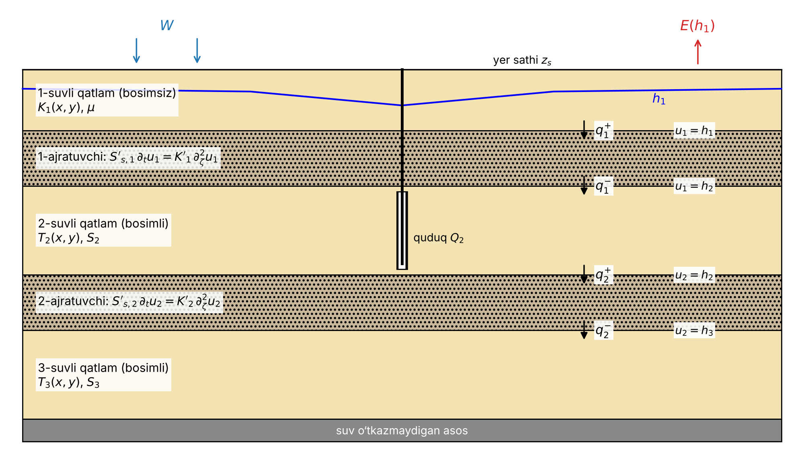

## 2.1. Uch qatlamli muhitda ajratuvchi qatlamlarning elastik suv berishini hisobga olgan filtratsiya masalasi

Ushbu band dissertatsiyaning 1-masalasiga bag‘ishlangan. Masala N. Ravshanov ilmiy maktabining uch qatlamli modellari davomi sifatida qo‘yiladi. Bandda masalaning asoslari, hisobiy sxemasi, tenglamalarning massa saqlanish va Darsi qonunlaridan keltirib chiqarilishi, tutashuv, boshlang‘ich va chegaraviy shartlar, global suv balansi, jarayonni belgilovchi o‘lchamsiz mezonlar va xususiy hollarga o‘tish keltiriladi. Masalani yechishning sonli usuli III bobda, hisoblash tajribalari IV bobda batafsil bayon qilinadi; bu yerda ularning asosiy natijalari qisqa beriladi.

### Asos bo‘ladigan ishlar va hal etilmagan masala

Ravshanov va boshq. (2026a) ikki ajratuvchi qatlam bilan bog‘langan uchta geterogen suvli qatlamdagi filtratsiyani ko‘rgan. Unda har bir suvli qatlamda filtratsiya koeffitsiyenti $x$, $y$ koordinatalarga bog‘liq, yacheykalararo koeffitsiyent o‘rta garmonik qiymat bilan olinadi, qatlamlararo almashinuv massani saqlovchi ko‘rinishda yoziladi va masala ADI sxemasi bilan yechiladi. Ajratuvchi qatlam esa elastik suv berishi hisobga olinmagan oqib o‘tish chegarasi sifatida qaraladi: oqim $K'(h_j-h_{j+1})/b'$ ga teng. Ravshanov va boshq. (2026b) to‘rt qatlamli tizimda filtratsiya koeffitsiyentining naporga bog‘liqligini hisobga olgan, ajratuvchilar u yerda ham elastik suv berishisiz.

Karimov va boshq. (2025) va Mukhamadiyev va boshq. (2026) bir xil uch qatlamli modelni bayon qilgan: yuqori qatlam bosimsiz, suv o‘tkazuvchanlik koordinatalarga bog‘liq, bug‘lanish kritik sathga bog‘liq, kam o‘tkazuvchan qatlam elastik rejimda. Bu qatlam tizimning eng pastida joylashgan va tubi suv o‘tkazmaydi, ya’ni u ikki suvli qatlamni bir-biri bilan bog‘lamaydi.

Qodirov (2023) dissertatsiyasida (shuningdek Ravshanov va boshq. 2017) ustidan va ostidan elastik rejimdagi kam o‘tkazuvchan qatlamlar bilan chegaralangan asosiy suvli qatlam uchun analitik yechimlar olingan. Bu Hantush (1960) ko‘rgan joylashuv: ajratuvchilar tashqarisida napor pasayishi berilgan yoki asos suv o‘tkazmaydi. Ustida grunt suvlari va bug‘lanish bo‘lgan chiziqlashtirilgan tizim, galereya va quduqlar batareyasi ham ko‘rilgan. Barcha parametrlar o‘zgarmas, yechimlar Laplas va Xankel almashtirishlari bilan olingan.

Xalqaro adabiyotda ajratuvchining elastik suv berishi analitik (Hantush 1960; Neuman, Witherspoon 1969; Hemker 1985; Hemker, Maas 1987; Cihan va boshq. 2011) va MODFLOW paketlarida (TLK1, Leake va boshq. 1994; CSUB, Hughes va boshq. 2022) hisobga olingan. Analitik yechimlarda qatlamlar bir jinsli va bosimli, oqim radial. MODFLOW da ajratuvchini alohida model qatlamlari bilan tasvirlash mumkin, lekin bog‘langan sxemaning turg‘unligi tahlil qilinmaydi.

2.1-jadval. 1-masalaga asos bo‘ladigan ishlarda mavjud va mavjud bo‘lmagan qismlar.

| Ish | Modelda bor | Modelda yo‘q |
|---|---|---|
| Ravshanov va boshq. 2026a (Hydrology 13, 276) | uchta suvli qatlam, ikki ajratuvchi; $K_k(x,y)$; massani saqlovchi almashinuv; o‘rta garmonik qiymat; ADI | ajratuvchining elastik suv berishi; bosimsiz qatlam; quduq; bug‘lanish; turg‘unlik isboti |
| Karimov va boshq. 2025; Mukhamadiyev va boshq. 2026 | bosimsiz yuqori qatlam; $T(x,y)$; bug‘lanish; elastik rejimdagi kam o‘tkazuvchan qatlam | elastik rejimdagi qatlam ikki suvli qatlam orasida emas; turg‘unlik isboti |
| Qodirov 2023; Ravshanov va boshq. 2017 | elastik rejimdagi ikki ajratuvchi orasidagi suvli qatlam; grunt suvlari va bug‘lanish (chiziqlashtirilgan) | uchta bog‘langan suvli qatlam; koordinatalarga bog‘liq parametrlar; sonli yechim |
| Hemker, Maas 1987; Cihan va boshq. 2011 | $n$ ta suvli qatlam, barcha ajratuvchilarda elastik suv berishi | bir jinsli bosimli qatlamlar; bosimsiz qatlam va bug‘lanish yo‘q |
| MODFLOW 6 (CSUB, qatlamli tasvir) | ajratuvchining elastik suv berishi, ixtiyoriy soha | bog‘langan sxemaning turg‘unlik tahlili |

Jadvaldan quyidagi hal etilmagan masala kelib chiqadi: suvli qatlamlar orasidagi har bir ajratuvchida elastik suv berishi, barcha qatlamlarda $K(x,y)$, nochiziqli bosimsiz yuqori qatlam, infiltratsion ta’minot, bug‘lanish va quduqlar bitta massani saqlovchi sxemada birgalikda hisobga olinmagan, bunday sxemaning turg‘unligi va monotonligi isbotlanmagan. Ajratuvchining elastik suv berishini qachon hisobga olmaslik mumkinligi uchun aniq mezon ham yo‘q: adabiyotda faqat $t_c$ xarakterli vaqti tilga olinadi.

### Hisobiy sxema va farazlar

Tizim yuqoridan pastga $k=1,2,3$ tartibda raqamlangan uchta suvli qatlam va $j=1,2$ ikkita ajratuvchi qatlamdan iborat (2.1-rasm). $j$-ajratuvchi $j$- va $(j+1)$-suvli qatlamlar orasida joylashgan. Gorizontal tekislikdagi soha $\Omega\subset\mathbb R^2$ ixtiyoriy shaklda, chegarasi $\Gamma=\Gamma_D\cup\Gamma_N$. 3-qatlamning tubi suv o‘tkazmaydi.

{width=16cm}

2.1-rasm. Uch qatlamli tizimning hisobiy sxemasi: grunt suvlari sathi $h_1$, infiltratsion ta’minot $W$ va bug‘lanish $E(h_1)$ bo‘lgan bosimsiz 1-qatlam; bosimli 2- va 3-qatlamlar; vertikal koordinatasi $\zeta$ va chegaralardagi oqimlari $q^\pm_j$ bo‘lgan ajratuvchilar; 2-qatlamdagi quduq.

Quyidagi farazlar qabul qilinadi:

1. Suvli qatlamlarda oqim gorizontal (Dyupyui farazi), ajratuvchilarda vertikal (A.N. Myatiev, M.S. Hantush farazi). Bu $K'\ll K_k$ bo‘lganda o‘rinli.
2. Suv va skelet elastik siqiladi; bosimli qatlamlar va ajratuvchilarda elastik suv zaxirasi naporga chiziqli bog‘liq.
3. 1-qatlam bosimsiz, suvga to‘yingan qalinligi $h_1-z_0$, suv berish koeffitsiyenti $\mu$. 2- va 3-qatlamlar doimo bosimli.
4. Sizot suvlari sathidan bug‘lanish uning chuqurligiga bog‘liq (S.F. Averyanov qonuni).
5. Har bir quduqning filtri bitta suvli qatlamda joylashgan, sarfi berilgan.
6. Har bir nuqtada muhit izotrop; filtratsiya koeffitsiyenti, qalinliklar va elastik suv berish koeffitsiyentlari $x$, $y$ koordinatalarga bog‘liq.

### Suvli qatlamlar tenglamalarini keltirib chiqarish

$k$-suvli qatlamda asosi $dx\,dy$ bo‘lgan va suvga to‘yingan qalinlikni to‘liq egallagan vertikal prizmani qaraymiz. Massa saqlanish qonuniga ko‘ra prizmadagi suv hajmining o‘zgarishi yon tomonlar, yuqori va pastki yuzalar hamda quduqlar orqali o‘tgan suv miqdoriga teng:

$$\frac{\partial V_k}{\partial t}=-\nabla\cdot\mathbf Q_k+(\text{vertikal kirish})-(\text{vertikal chiqish})-\sum_iQ_{ki}\,\delta(\mathbf x-\mathbf x_i),\tag{2.1}$$

bu yerda $V_k$ birlik yuzaga to‘g‘ri keladigan suv hajmi, m; $\mathbf Q_k$ birlik kenglik orqali gorizontal sarf, m²/sut; $\delta$ Dirak funksiyasi. Dyupyui farazida napor qalinlik bo‘yicha o‘zgarmaydi, shuning uchun Darsi qonuni $\mathbf q=-K_k\nabla h_k$ ni qalinlik bo‘yicha integrallab quyidagini olamiz:

$$\mathbf Q_k=-K_kb_k\nabla h_k=-T_k\nabla h_k.\tag{2.2}$$

Bosimli qatlamda zaxira suv va skeletning siqilishi hisobiga o‘zgaradi: $\partial V_k/\partial t=S_{s,k}b_k\,\partial h_k/\partial t=S_k\,\partial h_k/\partial t$. Bosimsiz qatlamda (2.2) dagi qalinlik $h_1-z_0$ ga teng, zaxira esa asosan sath siljiganda g‘ovaklarning to‘lishi va bo‘shashi hisobiga o‘zgaradi: $\partial V_1/\partial t=\mu\,\partial h_1/\partial t$. 1-qatlam yuqori yuzasiga infiltratsion ta’minot $W$ keladi va bug‘lanish $E$ ketadi. $j$-ajratuvchi bilan umumiy yuzadan $j$-qatlam pastga yo‘nalgan $q^+_j$ oqimni yo‘qotadi, $(j+1)$-qatlam esa $q^-_j$ oqimni oladi. Bu hadlarni (2.1) ga qo‘yib, quyidagi tenglamalarni olamiz:

$$\mu\frac{\partial h_1}{\partial t}=\nabla\cdot\big(K_1(h_1-z_0)\nabla h_1\big)+W-E(h_1)-q^{+}_1-\sum_i Q_{1i}\,\delta(\mathbf x-\mathbf x_i),\tag{2.3}$$

$$S_2\frac{\partial h_2}{\partial t}=\nabla\cdot(T_2\nabla h_2)+q^{-}_1-q^{+}_2-\sum_i Q_{2i}\,\delta(\mathbf x-\mathbf x_i),\tag{2.4}$$

$$S_3\frac{\partial h_3}{\partial t}=\nabla\cdot(T_3\nabla h_3)+q^{-}_2-\sum_i Q_{3i}\,\delta(\mathbf x-\mathbf x_i).\tag{2.5}$$

Bu yerda $h_k$ – $k$-qatlamdagi napor, m; $T_k=K_kb_k$ – suv o‘tkazuvchanlik, m²/sut; $S_k$ – elastik suv berish koeffitsiyenti; $z_0$ – 1-qatlam tubining belgisi, m; $Q_{ki}$ – $k$-qatlamdagi $i$-quduq sarfi, m³/sut.

### Ajratuvchi qatlam tenglamasini keltirib chiqarish

$\zeta\in[0,b'_j]$ orqali $j$-ajratuvchining yuqori chegarasidan pastga o‘lchanadigan chuqurlikni belgilaymiz. Ajratuvchining hajm elementida massa saqlanish qonuni $S'_{s,j}\,\partial u_j/\partial t=-\nabla\cdot\mathbf q'$, Darsi qonuni $\mathbf q'=-K'_j\nabla u_j$ ko‘rinishda yoziladi. Divergensiyaning gorizontal qismi vertikal qismiga $(b'/L)^2$ tartibdagi nisbatda bo‘ladi, $L$ napor gorizontal yo‘nalishda sezilarli o‘zgaradigan masofa. Bundan tashqari, $K'\ll K$ bo‘lganda tok chiziqlari chegarada sinib, ajratuvchi ichida deyarli vertikal yo‘naladi. Faqat vertikal qismni qoldirib, pastga musbat $q_z=-K'_j\,\partial u_j/\partial\zeta$ bilan quyidagi tenglamani olamiz:

$$S'_{s,j}\frac{\partial u_j}{\partial t}=K'_j\frac{\partial^2u_j}{\partial\zeta^2},\qquad 0<\zeta<b'_j.\tag{2.6}$$

Ajratuvchi va suvli qatlam chegarasida napor sakrashi cheksiz katta oqimni talab qiladi, shuning uchun naporlar teng. Chegaralardagi oqimlar ajratuvchidagi Darsi oqimining chegaradagi qiymatlariga teng. Shunday qilib, tutashuv shartlari quyidagicha yoziladi:

$$u_j\big|_{\zeta=0}=h_j,\qquad u_j\big|_{\zeta=b'_j}=h_{j+1},\tag{2.7}$$

$$q^{+}_j=-K'_j\frac{\partial u_j}{\partial\zeta}\Big|_{\zeta=0},\qquad q^{-}_j=-K'_j\frac{\partial u_j}{\partial\zeta}\Big|_{\zeta=b'_j}.\tag{2.8}$$

(2.6) ni ajratuvchi qalinligi bo‘yicha integrallab, (2.8) dan foydalansak,

$$\frac{d}{dt}\int_0^{b'_j}S'_{s,j}u_j\,d\zeta=q^+_j-q^-_j\tag{2.9}$$

hosil bo‘ladi: yuqoridan kirgan va pastdan chiqqan oqimlar farqi ajratuvchidagi elastik suv zaxirasining o‘zgarish tezligiga teng. Demak $q^+_j\ne q^-_j$ farqi aynan ajratuvchining elastik suv berishini ifodalaydi.

### Bug‘lanish, boshlang‘ich va chegaraviy shartlar

Bug‘lanish S.F. Averyanov qonuni bo‘yicha hisoblanadi:

$$E(h_1)=E_0\Big(1-\frac{z_s-h_1}{\Delta}\Big)^n,\quad 0\le z_s-h_1\le\Delta;\qquad E=0,\quad z_s-h_1>\Delta,\tag{2.10}$$

bu yerda $z_s$ – yer sathi belgisi, $E_0$ – sath yer yuzasida bo‘lgandagi bug‘lanish, $\Delta$ – bug‘lanish to‘xtaydigan kritik chuqurlik, $n$ – daraja ko‘rsatkichi.

Boshlang‘ich shartlar:

$$h_k(\mathbf x,0)=h_k^0(\mathbf x),\qquad u_j(\mathbf x,\zeta,0)=u_j^0(\mathbf x,\zeta).\tag{2.11}$$

Odatda boshlang‘ich holat sifatida quduqlarsiz statsionar holat olinadi; unda $u_j^0$ $\zeta$ bo‘yicha chiziqli. Chegaraviy shartlar: $\Gamma_{D,k}$ qismda napor berilgan (birinchi tur shart), $\Gamma_{N,k}$ qismda oqim nolga teng (ikkinchi tur shart):

$$h_k=g_k\ \ (\Gamma_{D,k}\text{ da}),\qquad T_k\frac{\partial h_k}{\partial n}=0\ \ (\Gamma_{N,k}\text{ da}).\tag{2.12}$$

(2.3)–(2.12) masalaning to‘liq matematik qo‘yilishini tashkil etadi.

### Global suv balansi

(2.3)–(2.5) ni $\Omega$ bo‘yicha integrallab, ikkala ajratuvchi uchun $\Omega$ bo‘yicha integrallangan (2.9) ni qo‘shsak, $q^\pm_j$ almashinuv hadlari qisqaradi:

$$\frac{d}{dt}\Big[\int_\Omega(\mu h_1+S_2h_2+S_3h_3)\,d\mathbf x+\sum_j\int_\Omega\!\int_0^{b'_j}S'_{s,j}u_j\,d\zeta\,d\mathbf x\Big]=\int_\Omega(W-E)\,d\mathbf x-\sum Q+\sum_k\oint_{\Gamma_{D,k}}T_k\frac{\partial h_k}{\partial n}\,ds.\tag{2.13}$$

Suvli qatlamlar va ajratuvchilar zaxirasining o‘zgarishi infiltratsiya va bug‘lanish farqidan quduqlar sarfini ayirib, chegaradan kelgan oqimni qo‘shganiga teng. Sonli sxema (2.13) ning diskret ko‘rinishini aniq bajarishi kerak (III bob).

### O‘lchamsiz mezonlar

O‘lchamsiz chuqurlik $\xi=\zeta/b'$ va vaqt $\theta=t/t_c$ kiritilsa, (2.6) tenglama $\partial u/\partial\theta=\partial^2u/\partial\xi^2$ ko‘rinishga keladi, bu yerda

$$t_c=\frac{b'^2S'_s}{K'}=\frac{b'S'}{K'},\qquad S'=S'_sb'\tag{2.14}$$

ajratuvchining xarakterli vaqti. $t\ll t_c$ da ajratuvchi faqat chegaralari yaqinida javob beradi va zaxirasidan suv ajratadi; $t\gg t_c$ da undagi napor taqsimoti chiziqliga yaqinlashadi. Herrera va Figueroa (1969) dagi xotira vaqti $3S'b'/(\pi^2K')\approx0{,}30\,t_c$.

$t_c$ ajratuvchi qanchalik tez muvozanatga kelishini ko‘rsatadi, lekin u suvli qatlamlarga nisbatan qancha suv berishini ko‘rsatmaydi. Buni ikkinchi mezon, elastik suv berish koeffitsiyentlari nisbati o‘lchaydi:

$$\varepsilon=S'\Big/\sum_kS_k.\tag{2.15}$$

Hantush (1960) hamda Neuman va Witherspoon (1969) yechimlarida bu rolni $S'/S$ nisbati bajaradi. IV bobdagi hisoblashlar ikkala mezon ham zarurligini ko‘rsatadi (2.3-jadval).

### Xususiy hollarga o‘tish

1. $S'_s=0$ bo‘lsa, (2.6) dan $u_j$ $\zeta$ ga chiziqli bog‘liq va (2.8) dan

$$q^+_j=q^-_j=\frac{K'_j}{b'_j}\,(h_j-h_{j+1})\tag{2.16}$$

kelib chiqadi. Bu Ravshanov va boshq. (2026a) dagi almashinuv. Demak u (2.3)–(2.12) modelning $S'_s\to0$ dagi limit holati.

2. Ikkinchi suvli qatlam ikki ajratuvchi orasida, ajratuvchilar tashqarisidagi naporlar o‘zgarmas va parametrlar bir jinsli bo‘lsa, Hantush (1960) va Qodirov (2023) ko‘rgan masala olinadi.

3. $S'_s=0$, yuqori qatlam napori o‘zgarmas va qatlamlar bir jinsli bo‘lsa, Xantush–Jakob (1955) masalasi, ajratuvchi bo‘lmasa Teys (1935) masalasi olinadi.

4. Bir jinsli bosimli qatlamlar uchun (2.4)–(2.8) Laplas sohasida aniq yechiladi. $\lambda=b'\sqrt{pS'_s/K'}$ belgilash bilan ajratuvchi chegaralaridagi oqimlar

$$\bar q^+=\frac{K'}{b'}\lambda\,(\coth\lambda\,\bar h_j-\operatorname{csch}\lambda\,\bar h_{j+1}),\qquad \bar q^-=\frac{K'}{b'}\lambda\,(\operatorname{csch}\lambda\,\bar h_j-\coth\lambda\,\bar h_{j+1})\tag{2.17}$$

ko‘rinishda bo‘ladi va masala Hemker (1985) yondashuvi bo‘yicha Bessel funksiyalari orqali yechiladi. Bu yechim sonli modelni tekshirish uchun etalon bo‘lib xizmat qiladi.

### Yechish usuli va asosiy natijalar

Masala chekli hajmlar usuli va oshkormas Eyler sxemasi bilan yechiladi (III bob). Yacheykalararo o‘tkazuvchanlik o‘rta garmonik qiymat bilan olinadi. Har bir ajratuvchi ustuni $M$ ta qatlamchaga bo‘linadi, ustundagi noma’lumlar progonka bilan yo‘qotiladi va har bir ustun uchun $2\times2$ o‘lchamli simmetrik almashinuv matritsasi hosil bo‘ladi. Natijada faqat suvli qatlamlar naporlari uchun bitta simmetrik siyrak tizim yechiladi. Bosimsiz qatlam suv o‘tkazuvchanligi va bug‘lanish Pikar iteratsiyasi bilan aniqlanadi. Sxema uchun diskret massa saqlanishi, almashinuv matritsasining musbat yarim aniqligi, energiya normasida absolyut turg‘unlik va diskret maksimum prinsipi isbotlangan.

2.2-jadval. Sonli modelni tekshirish natijalari (IV bob).

| Tekshiruv | Natija |
|---|---|
| Teys, Xantush–Jakob yechimlari | $10^{-5}$, $10^{-4}$ nisbiy farq |
| Ikkala ajratuvchisida elastik suv berishi bo‘lgan uch qatlam, Laplas etaloni | 0,7% gacha |
| MODFLOW 6 (ajratuvchi 20 ta model qatlami bilan) | $4\cdot10^{-9}$ m gacha |
| Olsthoorn (2003), Hemker–Maas (1987) jadvali | 36 qiymat bosilgan 4 xonagacha mos |
| MLU "Two-aquifers" misoli | 0,29826 m, MLU bilan bir xil |
| Fazo va vaqt bo‘yicha yaqinlashish tartibi | 2,07–2,32 va 1,02–1,05 |
| Suv balansi qoldig‘i | $10^{-10}$ dan kichik |
| Dalem tajribasi (Kruseman, de Ridder 1990) | RMSE 5,80 mm; $S'=1{,}1\cdot10^{-3}$ |

2.3-jadval. Quduqli qatlamda ajratuvchining elastik suv berishi hisobga olingan va olinmagan modellar farqi ($t_c=2{,}5$ sut, $r=30$ m).

| $\varepsilon$ | Farq 5% dan katta bo‘lgan oxirgi $t/t_c$ | $t=10^3\,t_c$ dagi farq |
|---|---|---|
| 0,083 | 0,25 | 0,4% |
| 0,83 | 0,79 | 2,3% |
| 8,3 | $10^3$ dan katta | 6,6% |
| 83 | $10^3$ dan katta | 12% |

Kichik $\varepsilon$ da $t$ bir necha $t_c$ dan oshgandan keyin ajratuvchining elastik suv berishini hisobga olmaslik mumkin. $\varepsilon\gtrsim1$ da farq $t\gg t_c$ da ham saqlanadi, chunki ajratuvchidan ajralgan suv tizimning umumiy elastik suv zaxirasini oshiradi. Qalin gilli ajratuvchilar ($t_c=900$ va 3200 sut) va geterogen maydon bo‘lgan misolda elastik suv berishi quduqli qatlamda dastlabki napor pasayishini 18–30% ga sekinlashtiradi, taxminan 1 sutkada quduqlar suvining 26% i ajratuvchilardan keladi. Bir yildan keyin bosimsiz qatlamda grunt suvlari sathi elastik suv berishi hisobga olingan modelda 0,051 m ga, hisobga olinmagan modelda 0,060 m ga pasayadi. Demak elastik suv berishi hisobga olinmagan model bug‘lanish va sho‘rlanishni belgilaydigan sath pasayishini taxminan 14% ga oshirib baholaydi.

### 2.1-band bo‘yicha xulosa

1. Ravshanov maktabining uch qatlamli modeli (Ravshanov va boshq. 2026a) har bir ajratuvchida vertikal elastik rejim tenglamasi va ajratuvchi chegaralarida napor va oqim uzluksizligi bilan kengaytirildi. Model bosimsiz yuqori qatlam, infiltratsion ta’minot, Averyanov bug‘lanish qonuni, quduqlar va barcha parametrlarning $x$, $y$ koordinatalarga bog‘liqligini o‘z ichiga oladi.
2. Barcha tenglamalar massa saqlanish va Darsi qonunlaridan keltirib chiqarildi; global suv balansi (2.13) qatlamlararo almashinuv hadlarining qisqarishini ko‘rsatadi.
3. Ravshanov va boshq. (2026a) dagi almashinuv, Hantush (1960) va Qodirov (2023) masalasi, Xantush–Jakob va Teys masalalari modelning xususiy hollari sifatida olinadi.
4. Ajratuvchining elastik suv berishini hisobga olish zarurligi ikki mezon bilan aniqlanadi: $t/t_c$ va $\varepsilon=S'/\sum S$. Faqat $t_c$ ga asoslangan baho $\varepsilon\gtrsim1$ da noto‘g‘ri xulosaga olib keladi.

Natijalar Ravshanov N., Erkinov J. maqolasida bayon qilingan (qoralama, `1-masala` repozitoriysi).

### Bandda keltirilgan adabiyotlar

1. Ravshanov N., Shadmanov I., Adizova F., Shadmanova K., Sayidova N., Jurayeva N., Kamalova M. Quasi-3D numerical modeling of groundwater flow, particle transport, and clogging-induced interlayer leakage in heterogeneous multilayer aquifers // Hydrology. 2026. Vol. 13. Art. 276. DOI: 10.3390/hydrology13100276.
2. Ravshanov N., Shadmanova K., Shadmanov I. Numerical modeling of nonlinear groundwater flow in a heterogeneous four-layer porous medium // Hydrology. 2026. Vol. 13. Art. 181. DOI: 10.3390/hydrology13070181.
3. Karimov M., Yakhshiboev M., Rakhimova F., Yadgarova L. Modeling of groundwater flow in a multilayer porous medium based on a nonlinear mathematical model // Proc. SPIE. 2025. Vol. 13662. Art. 136620J. DOI: 10.1117/12.3072569.
4. Mukhamadiyev A., Karimov M., Khujakulov T., Sattarov O., Cho J. A nonlinear model of three-layer groundwater flow with evaporation dependent on the critical groundwater level // Mathematics. 2026. Vol. 14, No. 2. Art. 256. DOI: 10.3390/math14020256.
5. Кодиров К.Р. Математические модели и приближенно-аналитические методы массопереноса в многослойных средах: дис. … д-ра философии (PhD) по техн. наукам: 05.01.07. Ташкент: НИИ развития цифровых технологий и искусственного интеллекта, 2023.
6. Равшанов Н., Кодиров К., Исламов Ю.Н., Куканова М.А. Математическая модель фильтрации потока в трехслойном пласте и ее аналитическое решение // Проблемы вычислительной и прикладной математики. 2017. №1(7). С. 47–53.
7. Hantush M.S. Modification of the theory of leaky aquifers // Journal of Geophysical Research. 1960. Vol. 65, No. 11. P. 3713–3725. DOI: 10.1029/JZ065i011p03713.
8. Hantush M.S., Jacob C.E. Non-steady radial flow in an infinite leaky aquifer // Transactions, American Geophysical Union. 1955. Vol. 36, No. 1. P. 95–100. DOI: 10.1029/TR036i001p00095.
9. Theis C.V. The relation between the lowering of the piezometric surface and the rate and duration of discharge of a well using ground-water storage // Transactions, American Geophysical Union. 1935. Vol. 16, No. 2. P. 519–524. DOI: 10.1029/TR016i002p00519.
10. Neuman S.P., Witherspoon P.A. Theory of flow in a confined two aquifer system // Water Resources Research. 1969. Vol. 5, No. 4. P. 803–816. DOI: 10.1029/WR005i004p00803.
11. Hemker C.J. Transient well flow in leaky multiple-aquifer systems // Journal of Hydrology. 1985. Vol. 81, No. 1–2. P. 111–126. DOI: 10.1016/0022-1694(85)90170-2.
12. Hemker C.J., Maas C. Unsteady flow to wells in layered and fissured aquifer systems // Journal of Hydrology. 1987. Vol. 90, No. 3–4. P. 231–249. DOI: 10.1016/0022-1694(87)90069-2.
13. Cihan A., Zhou Q., Birkholzer J.T. Analytical solutions for pressure perturbation and fluid leakage through aquitards and wells in multilayered-aquifer systems // Water Resources Research. 2011. Vol. 47. Art. W10504. DOI: 10.1029/2011WR010721.
14. Herrera I., Figueroa V. G.E. A correspondence principle for the theory of leaky aquifers // Water Resources Research. 1969. Vol. 5, No. 4. P. 900–904. DOI: 10.1029/WR005i004p00900.
15. Leake S.A., Leahy P.P., Navoy A.S. Documentation of a computer program to simulate transient leakage from confining units using the modular finite-difference ground-water flow model. U.S. Geological Survey Open-File Report 94-59. 1994. DOI: 10.3133/ofr9459.
16. Hughes J.D., Leake S.A., Galloway D.L., White J.T. Documentation for the Skeletal Storage, Compaction, and Subsidence (CSUB) Package of MODFLOW 6. U.S. Geological Survey Techniques and Methods 6-A62. 2022. DOI: 10.3133/tm6A62.
17. Olsthoorn T.N. Matlab function hantushn (rubriek C. Maas) // Stromingen. 2003. Vol. 9, No. 3. P. 48–50.
18. Hemker C.J., Randall J. Modeling with MLU: Applying the multilayer approach to aquifer test analysis. Tutorial. 2010.
19. Kruseman G.P., de Ridder N.A. Analysis and Evaluation of Pumping Test Data. 2nd ed. ILRI Publication 47. Wageningen, 1990. 377 p.
20. Аверьянов С.Ф. Борьба с засолением орошаемых земель. М.: Колос, 1978. 288 с.
